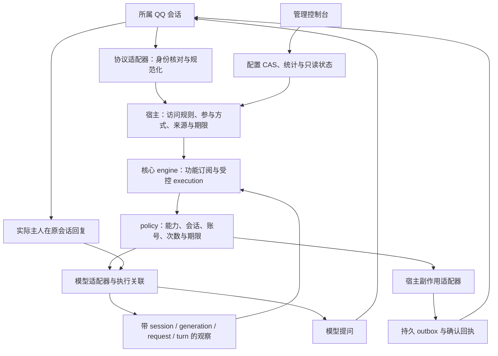

# 架构与边界

本文描述当前实现。扩展接口见 [EXTENDING.md](EXTENDING.md)，未决操作和接管恢复见 [RECOVERY.md](RECOVERY.md)。

## 一条消息的路径



协议层确认收到的是哪个账号的消息，宿主决定是否接纳，功能通过 `FeatureExecution` 请求副作用，policy 决定当前请求能否执行。网络请求被接受、执行结束、消息发送确认分别记录；任何一项都不能代替另一项的证据。

原生聊天入口是 [native-chat-runtime.ts](../src/host/native-chat-runtime.ts)。[native-inbound.ts](../src/host/native-inbound.ts) 处理输入与来源，[native-agent-coordinator.ts](../src/host/native-agent-coordinator.ts) 连接执行记录与 DSH 观察，[native-run-resources.ts](../src/host/native-run-resources.ts) 按资源归属排空。管理端通过领域 ports 调用这些服务。

## 模块职责

| 位置 | 职责 |
| --- | --- |
| `src/core/` | 内容、功能安装、事件调度、受控 execution、上下文与 policy。通过明确接口请求存储、模型和外部副作用。 |
| `src/contracts/` | 前后端和适配器可共享的纯 DTO、版本、限制与 decoder。 |
| `src/host/` | 持久会话、历史、任务、授权、资源、交互、包生命周期及原生聊天领域编排。 |
| `src/adapters/` | OneBot、DSH、模型协议、静态 profile 和受控文件访问。接收明确 DTO 与 ports。 |
| `src/storage/` | 私有 JSON、SQLite、CAS、持久 policy/state/outbox 的基础实现。 |
| `src/admin/` | 认证后的管理 HTTP 边界、请求校验、错误映射与领域服务装配。 |
| `web/` | 配置草稿、显式提交、统计和只读状态；资源读取按 API 身份去重和取消。 |
| `src/sdk/` | 外部扩展可消费的公共导出；发布包不包含管理服务器或网页。 |

人设、运行配置、偏好、记忆、资源和权限分别保存。人设文字、工具说明、模型回复、资源存在或功能声明都不能创建 grant。静态架构检查见 [source-rules.ts](../scripts/source-rules.ts)；功能、宿主与适配器的入口类型见 [core/types.ts](../src/core/types.ts)、[contracts/ports.ts](../src/contracts/ports.ts)。

## 配置、应用与运行

配置仓储 [native-configuration-repository.ts](../src/admin/native-configuration-repository.ts) 统一保存与引用约束。计划、人设、访问规则、连接、提供方、授权、部署和执行策略组成八个原生配置 revision。JSON 文档通过私有目录写锁和原子替换进行 CAS；过期 revision 返回冲突，读取失败不伪装成默认空配置。提供方和模型被方案或助手引用、人设被方案引用时，相应删除必须先明确处理引用。

保存目录与应用到 DSH 是两个操作。领域 planner 生成受管配置，profile 适配器只修改托管部分并读回核对；本机配置和模型元数据由自动发现提供，静态 YAML 不执行表达式。模型的输入类型来自真实元数据，缺少 image 证据时按 text 处理。DSH 凭据值是否已被运行中的外部进程加载，不由文件 provenance 推断为已验证。

[native-application.ts](../src/host/native-application.ts) 将明确应用请求保存为带 operationId 的 journal，再执行停止、准备、应用、迁移与启动。网页退出不会创建另一次应用，也不会凭 HTTP 读取成功就清除 unknown。助手目标由 [native-assistant-target.ts](../src/host/native-assistant-target.ts) 独立准备和应用，使用独立 preset/provider 路由；保存并启用助手配置会自动准备、应用并核验独立目标；需要加载且本机维护服务可用时会执行受控重载。只有真实主人准入的工作子会话在首轮前设置并读回全本机权限，父会话与普通聊天不改变。

[native-configuration-impact.ts](../src/host/native-configuration-impact.ts) 比较实际选中的方案、人设、提供方和已部署工具、连接、鉴权、执行等依赖。编辑未选中的目录对象不必停止当前聊天；实际依赖变化仍需按影响核验、迁移或重启。访问规则撤回在副作用前生效。secret 参与依赖指纹时不进入公开状态。

包配置有独立文档与 CAS revision。`packageConfigurations` 是 bootstrap 顶层的静态贡献，管理 registry 可在聊天未启动时提供配置。运行包通过声明的 `configurationIds` 使用同一 schema；热读取不会新增全局启动 revision，也不授予工具能力。唤醒设置随人设保存，见 [persona-wake.ts](../src/contracts/persona-wake.ts)；回复方式仍使用包配置，见 [native-output.ts](../src/contracts/native-output.ts)。

## 会话、执行与交付证据

会话绑定包含 conversationId、sessionId 和 generation；账号模式还包含 accountScope。sessionId 有持久反向索引及永久 ownership 记录，已退役 ID 不能跨会话或跨代复用。迁移和重置按确切绑定 revision/generation 更新，保留旧记录用于核对。

[native-execution.ts](../src/host/native-execution.ts) 将入站期限、请求、可信 claim receipt、用户消息和外部 turn 关联起来。`accepted` 只说明提交已被接受。丢流、超时或停止后的执行可保留隔离和 unknown；晚到结果记录在原执行，不自动发回或重新提交。取消也有独立的请求和确认状态。

同一会话正常忙碌时，新消息可以进入 [native-inbox.ts](../src/host/native-inbox.ts)，保留原到达期限并按发送者合并。未确认执行时暂缓后续提交，并有界核对原执行证据；重启保留未提交且未过期的输入，中断提交的批次记录未知结果后移出待发队列，不自动重放。全局 follow 池满时，新会话在创建前受到背压。管理端展示 pending/blocked 与原错误，不能把“停止接收”显示成“外部动作已停止”。

outbox 先保存发送意图，再经适配器发送并记录回执。confirmed、rejected 和 unknown 有不同含义；未知发送不靠换幂等键再试一次。独立工作、提醒、日历与交互也各自保存发生记录和归属。

## 扩展装配与清理

bootstrap 是由运维选定的可信代码，在宿主进程内运行，没有沙箱。声明、安装、运行就绪、获得授权和真实调用成功是不同事实。功能包请求外部副作用仍经自己的 execution 和 policy。

[native-packages.ts](../src/host/native-packages.ts) 在执行包代码前检查重复标识、依赖循环、服务版本与贡献冲突，按依赖顺序启动。阶段是 `prepare → migrate → install → recover → start`；停止按逆序执行排空、资源释放与注销。task、timer、订阅、服务与贡献都可登记 owner，清理失败保留 unknown，不再次调用未决 disposer。

状态键固定在 `package.<owner>.state`。包版本、stateSchemaVersion 与内容指纹保存在独立元数据，迁移按有界 CAS 页进行，不以更换版本命名空间丢弃旧数据。完整指纹覆盖范围由内容 manifest 明示；入口指纹、内置宿主文件集合与包树加依赖锁分别标注。

bootstrap 已完成 `create()` 但尚未安装时处于 `prepared`。若身份核对等安装前步骤失败，资源排空调用 `abandonPrepared()`：只允许尚未安装、无 pending start/stop 的 mount，abort 自身 lifetime 并标为 stopped。已安装、执行中或 unknown 的 mount 必须走原停止与核对规则，不能用此接口清除证据。

原生 runtime 的 `close()` 缓存同一个 Promise。即使聊天 `stop()` 返回 unknown，仍关闭独立的协议连接、提醒、记忆、事件与 hook 通道，最后返回原错误。未排空运行持有的主 store、lease 和 journal 继续保留；未决 raw control command 的 store 等待 raw drain 后才关闭。断开连接并不证明外部工作已结束。

## 多账号隔离

[native-accounts.ts](../src/host/native-accounts.ts) 管理注册协议与账号清单。每个新账号使用真实独立的私有目录 `accounts/<scope 哈希>/`、身份文档、runtime、数据库和连接，不依赖单一 store 的表面 namespace 来模拟隔离。默认 gateway 注册 OneBot，并核对 WS、HTTP 与 expectedSelfId 一致。

accountScope 贯穿消息、事件、会话、policy、effect scope 与出站幂等。scoped store 有固定账号 marker；缺 scope 或账号不匹配在进入副作用前拒绝。legacy 单账号保持兼容，采用明确接管流程后绑定原目录和既有键，不自动复制或推测所属账号。聊天与助手的 DSH 托管名称也按账号派生，避免两个账号覆盖同一个 preset。

管理接口使用全局 `/api/accounts`，账号内原生接口通过白名单 dispatch：

```text
GET /api/accounts/dispatch?account=<64位账号记录ID>&path=%2Fapi%2Fchat%2Fruntime
GET /api/accounts/dispatch?account=<ID>&path=%2Fapi%2Fchat%2Fwork&limit=20
```

`account` 是 registry 记录 ID，QQ accountId 保存在 accountScope 中。`path` 必须匹配该账号 bundle 的具体 `/api/chat/` 路由；其余 query 转交该路由。dispatch 不接受任意 URL，也不转发全局 settings。只读历史入口不会为了查询创建业务数据库、恢复 executor 或启动连接；迁移预览具有下文说明的专门语义。

重启时只恢复 ready 且持久意图为 desiredRunning 的账号；显式停止的账号不恢复。legacy 已接管后不再启动根目录旧 runtime，全局旧原生入口返回 `native_legacy_account_adopted`。应用 journal、包迁移或生命周期 unknown 继续阻止自动恢复。

## 控制台、QQ 与私有存储

控制台可以配置、明确应用、维护统计及读取状态。模型提问发到所属 QQ 会话，答复只认实际配置主人及原问题上下文；工具随白名单开放，外部工具确认按当前主人来源自动处理；网页没有批准、拒绝或代答入口。记忆 proposal 也不因网页纠正或读取而获得确认，global 共享必须由主人明确授权。

概览和功能页读取同一 [runtime projection](../src/host/native-runtime-projection.ts)。功能的 declared/installed/ready 与每次会话授权分别展示。账号切换重挂页面并取消旧读取，草稿、缓存和未知写入证据按 API 身份保留，不能把旧账号的异步响应应用到新账号。

SQLite 与 JSON 文件要求受控的私有目录和文件身份。现有 SQLite 只读查询保留 WAL 视图，不使用忽略 WAL 的 immutable 打开方式；SQLite 可能使用 WAL/SHM 协调文件，因此“只读”指不创建业务库或业务记录、不调度任务、不执行恢复副作用，不是字节级零磁盘写入。迁移 `GET /api/chat/sessions/migration` 会读取外部 DSH 预览证据并持久保存带 revision 的 prepared 计划，属于准备操作；提交仍需明确请求。

关键验收入口： [native-chat-runtime.test.ts](../test/native-chat-runtime.test.ts)、[native-account-gateway.test.ts](../test/native-account-gateway.test.ts)、[native-bootstrap.test.ts](../test/native-bootstrap.test.ts)、[native-package-state.test.ts](../test/native-package-state.test.ts)、[native-application.test.ts](../test/native-application.test.ts)。
